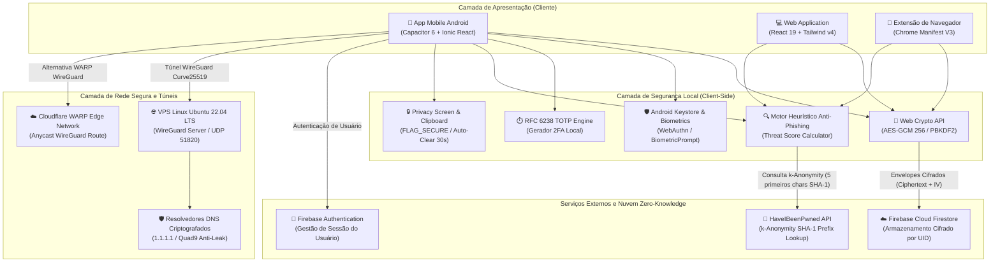
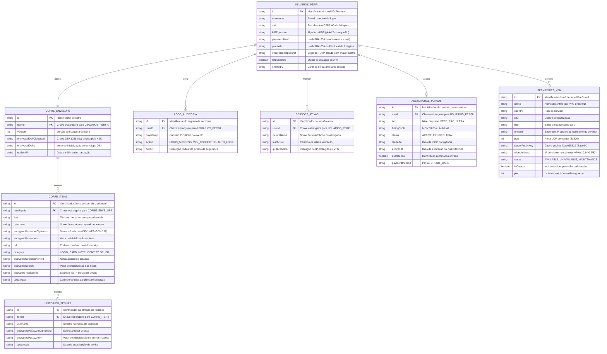
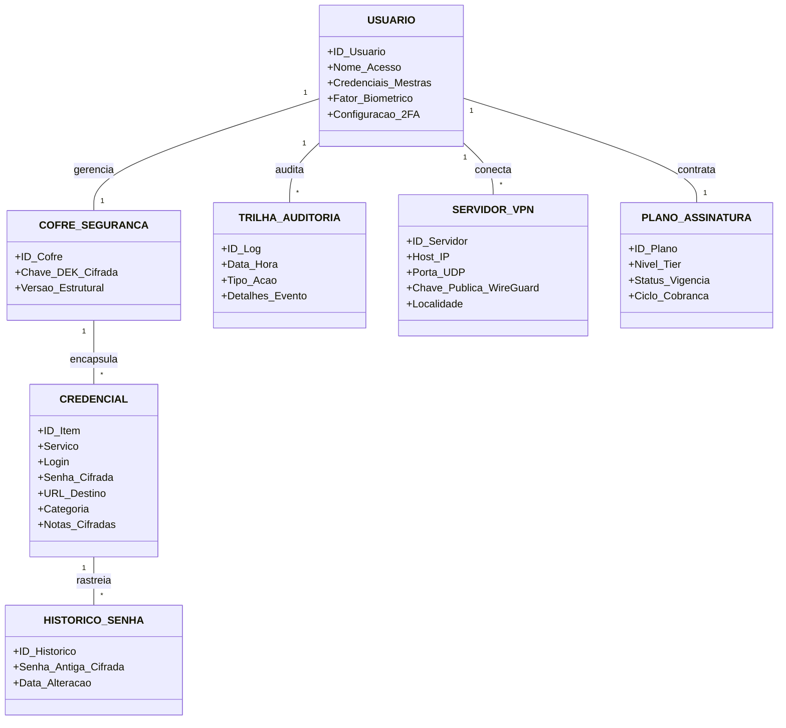
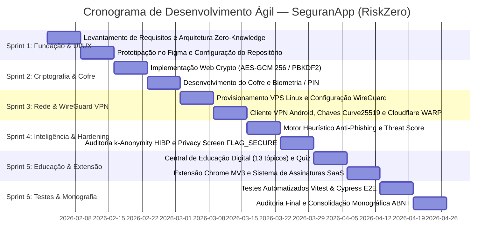

# Diagramas do Projeto SeguranApp (RiskZero) em Mermaid.js

Este documento reúne a especificação visual e lógica dos diagramas do Trabalho de Conclusão de Curso em sintaxe padrão Mermaid.js. Podem ser visualizados no GitHub, VS Code ou renderizados em PNG/SVG através do [Mermaid Live Editor](https://mermaid.live).

---

## 1. Diagrama de Arquitetura do Sistema e Fluxo de Dados

---

## 2. Diagrama Entidade-Relacionamento (DER Lógico)

---

## 3. Modelo Conceitual (MER Conceitual)

---

## 4. Gráfico de Gantt do Cronograma de Sprints

